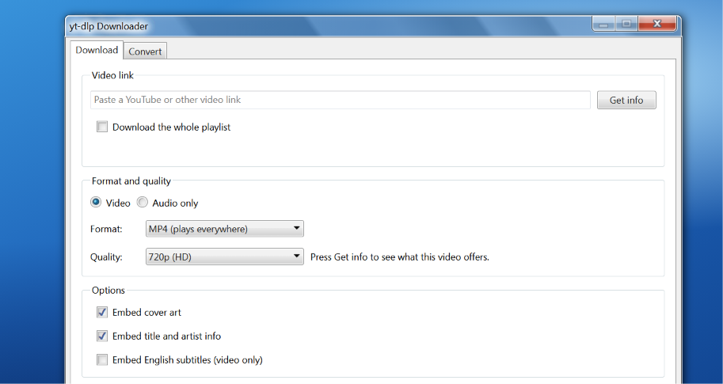

# aero-dlp

A Windows 7 styled frontend for [yt-dlp](https://github.com/yt-dlp/yt-dlp). Paste a link, pick a format and quality, and download. It runs locally and opens in your browser, dressed in Aero glass with [7.css](https://khang-nd.github.io/7.css/).



## Features

- **Video or audio only** with one switch
- **Video formats:** MP4, MKV, WebM
- **Audio formats:** MP3, M4A (AAC), Opus, OGG Vorbis, FLAC, WAV
- **Quality picker:** from Best available up to 4K down to 144p for video, and 320 down to 64 kbps for audio
- **Get info:** shows the title, thumbnail and duration, and narrows the quality list to what the video actually offers, with approximate file sizes
- **Playlists:** download a whole playlist into its own folder
- **Options:** embed cover art, embed title and artist info, embed English subtitles
- **Download list** with progress, speed and time left, plus cancel and clear
- **Details panel** with yt-dlp's full output, and a plain-language reason when a download fails
- **Folder picker** and an Open folder button
- **One-click yt-dlp update**, which also updates the YouTube challenge solver
- Remembers your last format, quality, folder and options

## Requirements

- Python 3.10 or newer
- [yt-dlp](https://github.com/yt-dlp/yt-dlp), installed with its `default` extras (this includes `yt-dlp-ejs`, which YouTube downloads need)
- [Deno](https://deno.com) 2.3.0 or newer, which yt-dlp uses as its JavaScript runtime for YouTube
- [ffmpeg](https://ffmpeg.org/download.html) on your PATH. It's needed for MP3 and other audio conversions, and for merging separate video and audio streams.
- A modern browser

## Install

```
git clone https://github.com/sosaspeaks/aero-dlp.git
cd aero-dlp
pip install -r requirements.txt
```

Then install ffmpeg and Deno if you don't have them.

| System | ffmpeg | Deno |
| --- | --- | --- |
| Windows | `winget install Gyan.FFmpeg` | `winget install DenoLand.Deno` |
| macOS | `brew install ffmpeg` | `brew install deno` |
| Linux | `sudo apt install ffmpeg` (Debian or Ubuntu) | see [Deno's install guide](https://docs.deno.com/runtime/getting_started/installation/) |

Open a new terminal afterwards so the updated PATH is picked up. You can check with `ffmpeg -version` and `deno --version`.

Deno is only needed for YouTube. Other sites work without it, but the app will show a warning in the meantime.

## Run

```
python ytdlp_frontend.py
```

The app opens in your browser. Press Ctrl+C in the terminal, or use the X in the app's title bar, to stop it.

The status bar at the bottom shows the yt-dlp, ffmpeg and Deno versions it found. A yellow notice at the top tells you if ffmpeg or Deno is missing, or if Deno is too old.

## Using it

1. Paste a link and press **Get info**. This step is optional, but it shows which qualities the video has.
2. Choose **Video** or **Audio only**, then a format and a quality.
3. Check the **Save to** folder.
4. Press **Download**. Click a row in the Downloads list to see the details for it.

## Troubleshooting

**HTTP Error 403: Forbidden**
YouTube is rejecting the download. Since late 2025, yt-dlp needs two things to download from YouTube: a JavaScript runtime (Deno) and the `yt-dlp-ejs` package. Check both:

1. Install Deno (see above) and restart the app.
2. Make sure yt-dlp was installed with its extras: `pip install -U "yt-dlp[default]"`. Plain `pip install yt-dlp` doesn't include `yt-dlp-ejs`. The **Update yt-dlp** button does this for you.

See yt-dlp's [EJS setup guide](https://github.com/yt-dlp/yt-dlp/wiki/EJS) for other runtimes and install methods.

**Deno missing in the status bar, even though you installed it**
The app only sees the PATH it was started with. Close the terminal, open a new one, and start the app again. The app also checks the usual Deno install folders (including the winget and `~/.deno/bin` locations) and passes the path to yt-dlp itself, so a stale PATH usually isn't a problem. If it still says missing, run `deno --version` in the same terminal to confirm Deno works there. yt-dlp needs Deno 2.3.0 or newer, and the app tells you if yours is older.

**ffmpeg missing in the status bar**
Install ffmpeg as described above and open a new terminal before starting the app.

**Lost connection to the app**
The server has stopped, or you're looking at an old browser tab. Close old tabs and start the app again. If the app crashed, the details are in the terminal and in `ytdlp_frontend.log` next to the script.

**The page has no Windows 7 styling**
7.css is loaded from a CDN, so the page needs an internet connection. For offline use, download `7.css` and save it next to `ytdlp_frontend.py`. It will be used instead.

**The Browse button does nothing**
The folder picker needs Python's tkinter. If it isn't available, type the folder path into the box instead.

## How it works

`ytdlp_frontend.py` is a single file with no dependencies beyond Python's standard library. It starts a small web server bound to `127.0.0.1`, so it can't be reached from other computers, and serves the page. When you press Download, it runs yt-dlp as a separate process with options built from your choices, and reads its output to show progress.

## Responsible use

This tool is a frontend for yt-dlp and doesn't change what yt-dlp can do. You're responsible for following the terms of the sites you download from and for respecting copyright in your country.

## Credits

- [yt-dlp](https://github.com/yt-dlp/yt-dlp) does the actual downloading
- [7.css](https://github.com/khang-nd/7.css) provides the Windows 7 look
- [ffmpeg](https://ffmpeg.org/) handles merging and conversion

## License

[MIT](LICENSE)
